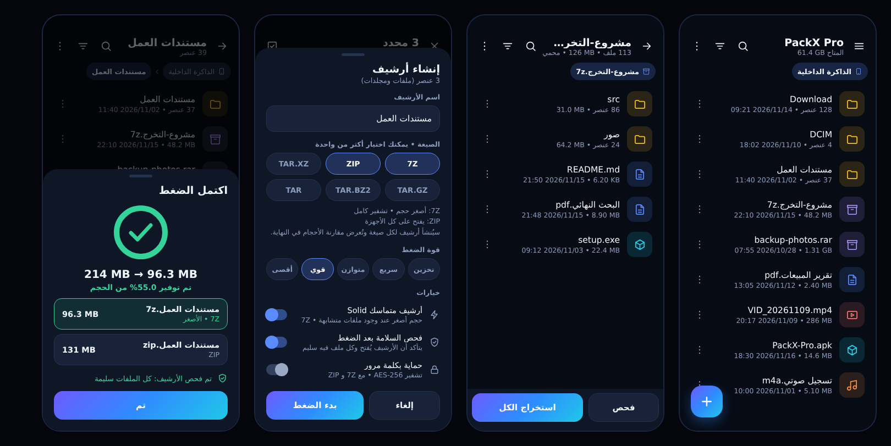

# PackX Pro v6.0 — مدير ملفات وأرشيفات

تطبيق أندرويد عربي لتصفح الملفات وضغطها وفك كل أنواع الأرشيفات تقريباً، مبني على محرك
7‑Zip 26.03 الأصلي. الإصدار 6 إعادة كتابة كاملة للواجهة والمحرك.



## الجديد في 6.0

**فتح وفك الضغط**
- يفتح 7Z و ZIP و RAR (بما فيها RAR5) و TAR و GZ و BZ2 و XZ و ZST و ISO و CAB و ARJ و LZH و WIM و DEB و RPM وغيرها.
- تصفّح الأرشيف كأنه مجلد: مجلدات داخلية، مسار علوي، بحث وفرز.
- فتح ملف من داخل الأرشيف مباشرة دون استخراج الباقي.
- استخراج الكل أو عناصر محددة (ملفات ومجلدات) إلى مجلد جديد، أو هنا، أو أي مجلد تتصفحه.
- عند وجود ملف بنفس الاسم: استبدال، تخطّي، أو إبقاء الاثنين.
- أرشيفات مقسّمة (‎.001) وأرشيفات محمية بكلمة مرور، مع طلب الكلمة تلقائياً.
- «فتح كأرشيف» لأي ملف مثل APK و DOCX و EXE.
- فحص سلامة أي أرشيف.

**الضغط**
- ست صيغ: 7Z • ZIP • TAR.XZ • TAR.GZ • TAR.BZ2 • TAR.
- اختيار أكثر من صيغة في عملية واحدة، مع مقارنة الأحجام وتمييز الأصغر في النهاية.
- خمس درجات: تخزين، سريع، متوازن، قوي، أقصى.
- الضغط يقرأ الملفات من مكانها مباشرة. لم يعد ينسخها إلى مساحة مؤقتة، فلا يحتاج مساحة إضافية بحجم الملفات.
- القاموس وعدد الأنوية يُختاران حسب ذاكرة الجهاز الفعلية لتفادي توقف العملية.
- تشفير AES‑256 مع 7Z و ZIP، وإخفاء أسماء الملفات مع 7Z.
- تقسيم إلى أجزاء (25 MB حتى 4 GB).
- فحص سلامة تلقائي بعد الضغط.
- نسبة تقدم حقيقية واسم الملف الحالي، وزر إلغاء في التطبيق وفي الإشعار.

**مدير الملفات**
- تحديد متعدد مع شريط إجراءات: ضغط، نسخ، نقل، حذف، مشاركة.
- فرز بالاسم أو التاريخ أو الحجم أو النوع، وإظهار الملفات المخفية.
- أماكن سريعة (التنزيلات، الكاميرا…)، بطاقة الذاكرة، ومفضلة.
- صور مصغّرة، معلومات العنصر، حجم المجلد، وبصمة SHA‑256.
- مظهر داكن وفاتح أو حسب النظام.
- يستقبل الأرشيفات من التطبيقات الأخرى (فتح بواسطة PackX).

## البناء

**من GitHub (بدون حاسبة):** كل دفع إلى `main` يشغّل `.github/workflows/build.yml` ويُخرج الـ APK في
تبويب Actions ← آخر تشغيل ← Artifacts.

للتوقيع بمفتاح الإصدار نفسه (حتى يتحدث التطبيق فوق النسخ السابقة) أضف Secret باسم
`PACKX_RELEASE_KEY_PEM` يحتوي نص ملف المفتاح الخاص. بدونه يُوقَّع الـ APK بمفتاح تجريبي ويجب
حذف النسخة القديمة قبل التثبيت. **لا ترفع ملف المفتاح الخاص إلى المستودع.**

**من Android Studio:** افتح المشروع مع JDK 17 و Android SDK 35 ثم Build ← Build APK(s).

المحرك الجاهز موجود في `app/src/main/jniLibs` لمعماريات arm64‑v8a و armeabi‑v7a و x86_64.
مصدره في `third_party/7zip`، ولإعادة بنائه عبر Android NDK r27:

```bash
cd third_party/7zip/CPP/7zip/Bundles/Alone2
make -f makefile.gcc CC="$NDK_BIN/aarch64-linux-android26-clang" \
  CXX="$NDK_BIN/aarch64-linux-android26-clang++" \
  PROG=libpackx7zz.so O=/absolute/output/directory LIB2=-ldl
```

## بنية الكود

| الملف | الدور |
| --- | --- |
| `compression/SevenZip.java` | تشغيل محرك 7‑Zip: قراءة، فك، فحص، ضغط. بدون أي اعتماد على أندرويد. |
| `compression/ArchiveTree.java` | تحويل قائمة محتويات الأرشيف إلى مجلدات قابلة للتصفح. |
| `CompressionService.java` | تنفيذ العمليات الطويلة في الخلفية مع إشعار وإلغاء. |
| `FileBrowserActivity.java` | الشاشة الرئيسية: مدير الملفات ومتصفح الأرشيف. |
| `Sheets.java` و `ui/` | النوافذ السفلية وعناصر الواجهة. |

## ملاحظات

- نسبة الضغط تعتمد على البيانات. الفيديو والصور و APK مضغوطة أصلاً ولن تصغر إلا قليلاً.
- كلمة مرور ZIP يجب أن تكون بأحرف إنجليزية وأرقام ورموز. استخدم 7Z لكلمة مرور عربية.
- إنشاء RAR غير ممكن لأن الصيغة مغلقة. الفتح والاستخراج مدعومان.
- أندرويد 11 وما بعده يمنع الوصول إلى `Android/data` و `Android/obb`.

7‑Zip مرخّص وفق `third_party/7zip/DOC/License.txt` (LGPL مع قيد unRAR).

المطور: **مهند سات لنك**
